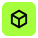
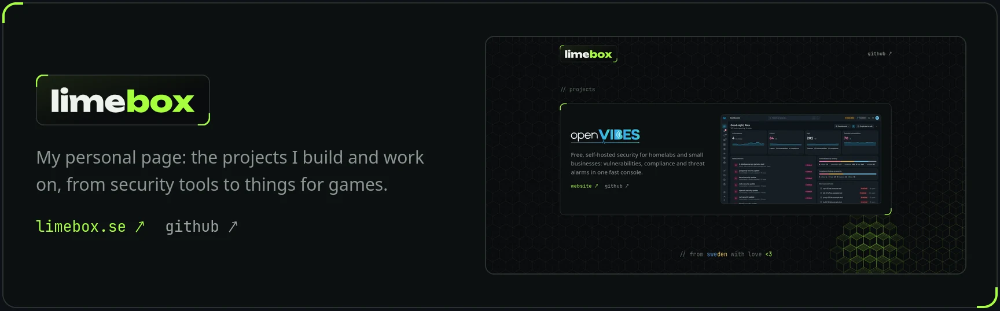
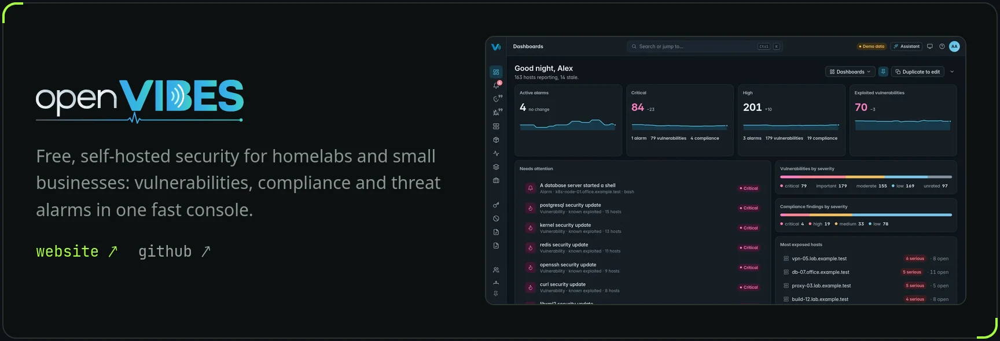

  

<code>// projects</code>

<a href="https://limebox.se">
  <picture>
    <source media="(prefers-color-scheme: light)" srcset="cards/limebox-light.webp">
    
  </picture>
</a>

<a href="https://limebox.se">limebox.se ↗</a> &nbsp; <a href="https://github.com/itismelime/limebox">github ↗</a>

<a href="https://openvibes-project.github.io/">
  <picture>
    <source media="(prefers-color-scheme: light)" srcset="cards/openvibes-light.webp">
    
  </picture>
</a>

<a href="https://openvibes-project.github.io/">website ↗</a> &nbsp; <a href="https://github.com/openvibes-project">github ↗</a>

<code>// from sweden with love &lt;3</code>

